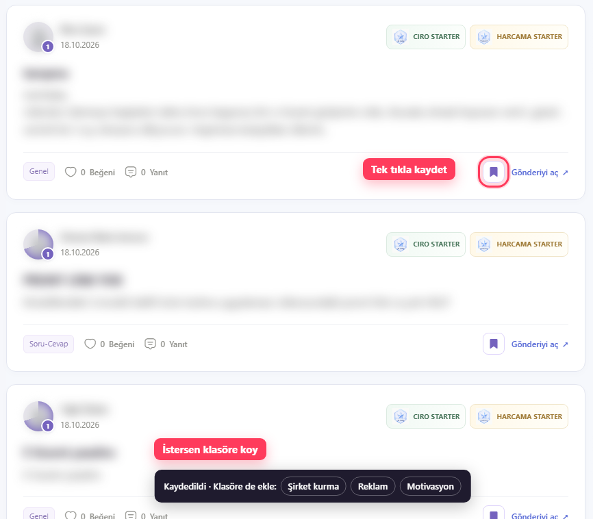
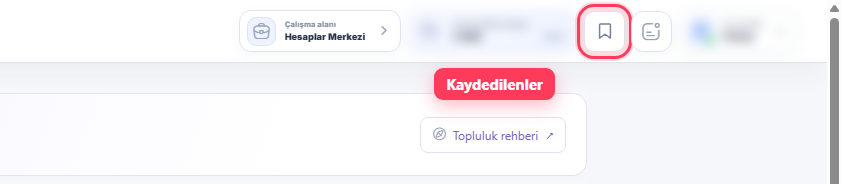
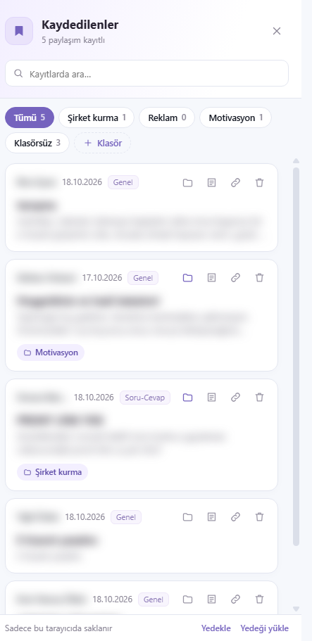
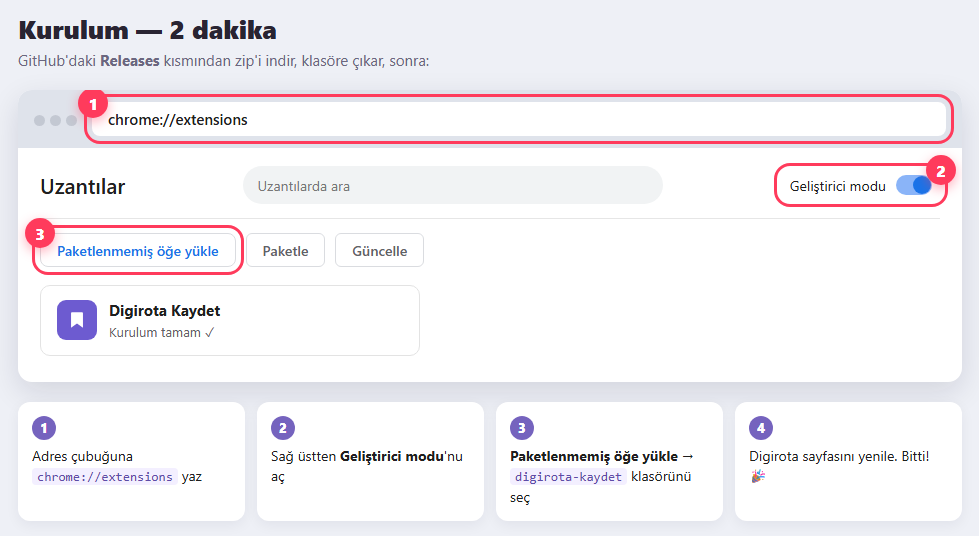

# Digirota Kaydet

Digirota Topluluk'taki paylaşımları tek tıkla kaydet, klasörlere ayır, sonra kolayca tekrar bul.

> Bu eklenti bir topluluk üyesi tarafından yapılmıştır, Digirota'nın resmi ürünü değildir.

## Ne yapar?

- Topluluktaki her paylaşımın altına, **Gönderiyi aç**'ın yanına bir **kaydet** simgesi ekler. Bir tıkla kaydeder, tekrar tıklayınca kayıttan çıkarır.

  

- Digirota'nın üst çubuğuna (Duyurular zilinin soluna) bir simge ekler:

  

- Bu simge sağdan **Kaydedilenler** panelini açar:

  

  - Kayda tıklayınca paylaşım hemen açılır.
  - Kayıtları **klasörlere** ayırabilirsin (ör. "Şirket kurma"), **not** ekleyebilir, **arama** yapabilirsin.
  - Paylaşımın linkini kopyalayabilirsin.
  - Kayıtlarını **yedekleyip** başka bir bilgisayara taşıyabilirsin.

## Güvenlik — neden güvenle kurabilirsin?

Bu eklenti **açık kaynaktır**. Kodun tamamı bu sayfada; 4 küçük dosya, sıkıştırılmamış ve açıklamalı. Bilen herkes ne yaptığını okuyabilir.

### Ne yapmaz

- ❌ Hiçbir sunucuya veri **göndermez**. Kodda internete istek atan tek bir satır yoktur (`fetch`, `XMLHttpRequest` vb. kullanılmaz).
- ❌ Şifrelerini, çerezlerini, hesap bilgilerini **okumaz**.
- ❌ Digirota dışındaki hiçbir siteyi **göremez**: bankanı, e-postanı, diğer sekmelerini.
- ❌ Dışarıdan kod indirip **çalıştırmaz**.

### Ne saklar

Sadece kaydettiğin paylaşımlar için: **linki, başlığı, yazarı, tarihi, kategorisi ve kısa bir önizleme**. Bir de senin eklediğin klasör adları ve notlar. Hepsi yalnızca **kendi tarayıcında** (`chrome.storage.local`) durur.

### İstediği izinler

Bu izinleri Chrome'da kendin de görebilirsin: `chrome://extensions` → Digirota Kaydet → **Ayrıntılar**.

| İzin | Neden |
|---|---|
| `https://app.digirota.com/*` | Kaydet simgelerini ve paneli sadece Digirota sayfalarına eklemek için. Başka siteye erişemez. |
| `storage` | Kayıtlarını kendi tarayıcında saklamak için. |

Chrome, bir eklentinin bu izinlerin dışına çıkmasına izin vermez. Kodu okumasan bile bu liste bir güvencedir.

### Kendin doğrula

1. Digirota'da **F12**'ye bas, **Ağ (Network)** sekmesini aç.
2. Bir paylaşımı kaydet, paneli aç, kayıtlar arasında gezin.
3. Eklentiden dışarıya hiçbir istek gitmediğini göreceksin.

### Sadece buradan indir

Eklentiyi **yalnızca bu GitHub sayfasından** indir. Başkasının gönderdiği zip'i kurma; kod değiştirilmiş olabilir. İstersen [Sürümler (Releases)](../../releases) sayfasındaki SHA-256 parmak iziyle indirdiğin dosyanın aynısı olduğunu kontrol edebilirsin:

```powershell
# Windows PowerShell
Get-FileHash .\digirota-kaydet.zip -Algorithm SHA256
```

## Kurulum (Chrome, Edge, Brave, Opera)



1. [Sürümler (Releases)](../../releases) sayfasından en son `digirota-kaydet.zip` dosyasını indir ve bir klasöre çıkar.
   Bu klasörü silme veya taşıma; eklenti oradan çalışır.
2. Adres çubuğuna yaz: `chrome://extensions` (Edge: `edge://extensions`, Brave: `brave://extensions`, Opera: `opera://extensions`).
3. **Geliştirici modu**'nu aç (Chrome'da sağ üstte).
4. **Paketlenmemiş öğe yükle**'ye bas ve çıkardığın `digirota-kaydet` klasörünü seç.
5. Digirota sekmeni yenile.

> Chrome açılışta "geliştirici modu uzantılarını devre dışı bırak" uyarısı gösterebilir. Çarpıya basıp geçebilirsin, eklenti çalışmaya devam eder.

Telefon tarayıcıları eklenti desteklemediği için sadece bilgisayarda çalışır.

## Güncelleme

1. Yeni sürümün zip'ini indir ve **aynı klasörün üstüne** çıkar.
2. `chrome://extensions` sayfasında eklentinin **yenile (↻)** simgesine bas.
3. Digirota sekmeni yenile.

Kayıtların silinmez.

## Bilmen gerekenler

- Eklentiyi kaldırırsan kayıtların da silinir. Önce paneldeki **Yedekle** ile yedek al.
- Digirota sayfa tasarımını değiştirirse simgeler görünmeyebilir. O durumda güncelleme gerekir.

## Dosyalar

| Dosya | Görevi |
|---|---|
| `manifest.json` | Eklentinin adı, sürümü ve izinleri |
| `content.js` | Paylaşımlara kaydet simgesini ve üst çubuk simgesini ekler |
| `panel.js` | Sağdan açılan Kaydedilenler paneli |
| `content.css` | Simgelerin ve bildirimin görünümü |
| `background.js` | Araç çubuğundaki eklenti simgesine basınca paneli açar |
| `docs/` | Bu sayfadaki görseller (eklentinin çalışması için gerekmez) |

## Lisans

[MIT](LICENSE). Özgürce kullanabilir, inceleyebilir ve geliştirebilirsin.
